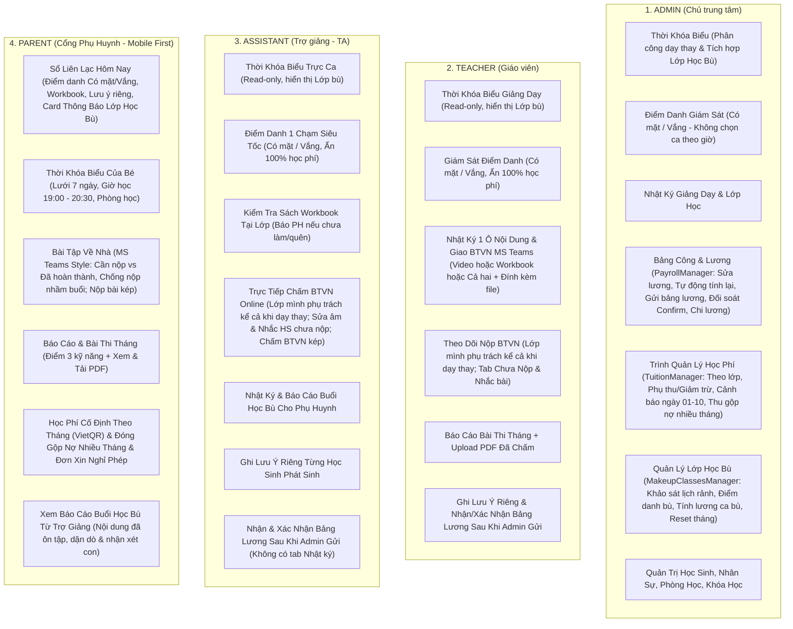

# TÀI LIỆU TIẾN ĐỘ DỰ ÁN & BÀN GIAO KỸ THUẬT
## HỆ THỐNG QUẢN LÝ TRUNG TÂM TIẾNG ANH MS. DUNG SHINY
*(Ms. Dung Shiny English Center Management System)*

> **Ngày cập nhật:** 23/11/2026  
> **Trạng thái hệ thống:** Hoàn thiện 100% Hệ Thống Quản Lý Toàn Diện: Tự Động Gửi Zalo Không Cần Ctrl+V (Auto-Send Engine), Hàng Đợi 2-3 Phút Chống Quét Spam Zalo, Tự Động Báo Cáo Điểm Danh Nhóm Zalo Lớp, Bàn Giao Lớp Học & Tự Động Khóa Tài Khoản Nhân Sự Nghỉ Việc, Tối Ưu Hóa Mobile-First Toàn Diện (Avatar Popover Menu, Bảng Vuốt Cảm Ứng, Safe-Area Insets) & Ứng Dụng Web Tiến Bộ PWA (Cài Đặt App Trực Tiếp Màn Hình Chính Trên iOS, Android, Desktop).  
> **Chất lượng mã nguồn:** TypeScript noEmit 0 errors, ESLint 0 errors, Next.js Dev Server 200 OK, 100% Validation & Unit Tests Passed (33/33 tests).  
> **Storage Data Version:** `ms_dung_shiny_center_data_v23_clean`  
> **Mục đích tài liệu:** Lưu trữ toàn bộ tiến độ, kiến trúc, quy chuẩn tư duy nghiệp vụ, các module chức năng và hướng dẫn bàn giao để chuyển đổi làm việc sang tài khoản/môi trường khác mà không bị gián đoạn.

---

## 1. TỔNG QUAN HỆ THỐNG & TECH STACK

- **Framework:** Next.js 14 (App Router)
- **Ngôn ngữ:** TypeScript 5.6
- **Giao diện:** Tailwind CSS, Lucide React (Bộ icon đồng bộ, chuẩn Mobile-First)
- **Quản lý dữ liệu:** 
  - Giai đoạn hiện tại (Prototype/Demo): `CenterContext` kết hợp `localStorage` tự động đồng bộ thời gian thực (`STORAGE_KEY: ms_dung_shiny_center_data_v23_clean`, hỗ trợ migration từ `ms_dung_shiny_center_data_v22`).
  - Đã có sẵn cấu trúc Database ORM: Prisma schema đầy đủ tại [`prisma/schema.prisma`](file:///d:/MsDungShinnyPrj_ver02/prisma/schema.prisma).
- **Cổng chạy máy chủ (Localhost):** `http://localhost:3000` / `http://localhost:3001`
- **Lệnh thực thi chính:**
  - `npm run dev`: Khởi chạy Next.js development server
  - `npm run lint`: Kiểm tra toàn bộ mã nguồn (Đảm bảo 0 lỗi)
  - `npm run build`: Đóng gói ứng dụng cho production (Verified Exit code 0)

---

## 2. QUY CHUẨN TƯ DUY NGHIỆP VỤ CỐT LÕI (BẮT BUỘC TUÂN THỦ)

### 2.1. Phân định vai trò & Trách nhiệm khi DẠY THAY
- **Quyền phân công dạy thay:** **CHỈ QUẢN TRỊ VIÊN (ADMIN)** mới có quyền phân công giáo viên hoặc trợ giảng dạy thay; GV và TA chỉ có quyền xem (Read-only).
- **Nguyên tắc phân định công việc khi có dạy thay:**
  - **Buổi học hôm đó:** Do **Giáo viên dạy thay** và **Trợ giảng trực thay** chịu trách nhiệm toàn bộ (viết nhật ký buổi học, giao bài tập về nhà của buổi dạy thay, ghi nhận xét và lưu ý riêng cho học sinh trong buổi hôm đó).
  - **Chấm bài tập về nhà & Theo dõi tiến độ:** Do **Giáo viên và Trợ giảng chính** của lớp chịu trách nhiệm xuyên suốt khóa học. Kể cả buổi học có người dạy thay, học sinh nộp bài tập thì GV và TA chính của lớp vẫn phải chấm bài và theo dõi tình hình nộp bài của học sinh lớp mình phụ trách.

### 2.2. Điểm danh 1-chạm tinh giản
- **Chỉ có 2 trạng thái duy nhất:** **Có mặt (`PRESENT`)** hoặc **Vắng (`ABSENT`)**.
- **Loại bỏ hoàn toàn:** Không có trạng thái Đi muộn (`LATE`), không có bộ lọc ca theo giờ (17:15, 19:15) gây rườm rà.
- **Ẩn 100% học phí:** Giao diện điểm danh của Trợ giảng và Giáo viên hoàn toàn không hiển thị bất kỳ thông tin nào liên quan đến học phí của học sinh.

### 2.3. Không sử dụng hệ thống sao thưởng
- Hệ thống sao thưởng (1-5 sao ⭐) đã được gỡ bỏ hoàn toàn khỏi toàn bộ các phân hệ (Điểm danh, Nhật ký, BTVN, Cổng phụ huynh).

### 2.4. Lưu ý riêng từng buổi (Incident Notes)
- Phân biệt rõ giữa *Nhận xét học tập định kỳ* và *Lưu ý riêng từng buổi* (`StudentIncidentNote`).
- Chỉ gửi riêng cho phụ huynh của học sinh có vấn đề phát sinh trong buổi học hôm đó (ví dụ: mất tập trung, nghịch ngợm, quên đồ dùng, mệt mỏi, buồn ngủ...) thay vì gửi đại trà.

### 2.5. Nhật ký giảng dạy: Gộp 1 ô nội dung duy nhất
- Không chia vụn thành 4 ô (Chủ đề, Từ vựng, Ngữ pháp, Nhận xét chung) mà **gộp chung thành 1 ô duy nhất** (`lessonContent`: Nội dung buổi học).
- Giáo viên có thể tự do trình bày tóm tắt toàn bộ bài học và không khí lớp học một cách nhanh chóng, súc tích.

### 2.6. Giao BTVN phong cách Microsoft Teams & Giải pháp BTVN Kép
- **3 hình thức nộp bài linh hoạt:**
  1. `VIDEO`: Chỉ quay video phát âm / thuyết trình.
  2. `WORKBOOK`: Chỉ làm bài tập trong sách Workbook / Worksheet / Vở viết.
  3. `BOTH` (BTVN Kép): **Giao cả Quay video + Workbook/Worksheet**.
- Phụ huynh khi nộp bài tập sẽ có 2 khu vực nộp rõ ràng (1 mục nộp video clip và 1 mục chụp ảnh các trang bài tập trong sách).
- Trợ giảng có giao diện chấm kép: xem video clip phát âm và xem ảnh bài làm sách để nhận xét và cho điểm trọn vẹn cả 2 phần.
- **Đính kèm tài liệu từ máy tính:** Tích hợp bộ chọn tệp máy tính cho phép giáo viên duyệt và chọn tệp trực tiếp từ các thư mục trong máy tính (PDF, Word, Excel, PowerPoint, Ảnh, Zip...), hiển thị tên file và dung lượng thực tế.
- **Khóa theo buổi học (Session-Locked):** Khóa chặt bài tập theo ngày và buổi học, loại bỏ hoàn toàn lỗi phụ huynh nộp nhầm buổi.

### 2.7. Trợ giảng: Bỏ tab Nhật ký buổi học & Chấm BTVN chuyên trách
- **Xóa tab Nhật ký buổi học:** Trợ giảng không phải viết nhật ký buổi học (giáo viên chịu trách nhiệm chính về giáo án và nhật ký).
- **Trợ giảng phụ trách 5 nhiệm vụ trọng tâm:**
  1. Thời khóa biểu trực ca (Read-only).
  2. Điểm danh đầu giờ (Có mặt / Vắng, ẩn học phí).
  3. Kiểm tra sách bài tập Workbook tại lớp (Báo phụ huynh nếu quên sách hoặc chưa làm).
  4. Trực tiếp chấm BTVN online (Chấm điểm từ 1-10, sửa lỗi phát âm và ngữ pháp; hỗ trợ chấm bài tập kép).
  5. Ghi lưu ý riêng cho học sinh có phát sinh và Xác nhận bảng lương cá nhân.

### 2.8. Theo dõi nộp BTVN: Quản lý học sinh chưa nộp bài
- Cả Giáo viên và Trợ giảng đều có bộ lọc 3 tab: `Tất Cả`, `Đã Nộp`, và **`Chưa Nộp`**.
- Tab `Chưa Nộp` liệt kê đầy đủ học sinh chưa nộp bài, mã học viên, họ tên và số điện thoại phụ huynh kèm nút gửi tin nhắn nhắc nhở (`[ 🔔 Nhắc Nộp Bài ]`) và nút hàng loạt (`[ ⚡ Nhắc Tất Cả HS Chưa Nộp ]`).

### 2.9. Bảng công & Lương: Quy trình 4 bước hoàn chỉnh
1. **`DRAFT` (Bản nháp nội bộ):** Admin có toàn quyền chỉnh sửa trực tiếp số giờ công, đơn giá theo giờ, **Phụ cấp đi lại**, **Phụ cấp công việc**, **Khoản Khác (+/-)** và ghi chú chỉ đạo.
   - **Nút tự động tính lại giờ dạy:** Trong trường hợp Admin nhập sai giờ, chỉ cần bấm nút `[ 🔄 Tự Động Tính Lại Giờ Dạy ]` để hệ thống tự động quét lại toàn bộ danh sách ca dạy thực tế trong tháng và khôi phục chính xác 100% số giờ đứng lớp.
   - **Khoản Khác (+/-):** Cho phép nhập giá trị dương (+) để cộng thêm thưởng/phụ cấp phát sinh hoặc giá trị âm (-) để giảm trừ phạt/nghỉ.
   - Khi ở trạng thái DRAFT, GV và TA thấy thông báo *"Admin đang tổng hợp bảng lương..."* và nút Confirm bị khóa.
2. **`SENT_TO_STAFF` (Admin gửi bảng lương):** Admin bấm `[ 🚀 Gửi Bảng Lương ]` (cho từng người hoặc gửi đồng loạt tất cả nhân sự). Hệ thống ghi nhận thời điểm `sentAt` và thông báo tới GV/TA.
3. **`CONFIRMED` (Nhân sự xác nhận):** GV/TA kiểm tra chi tiết từng ca dạy/trực và tổng tiền thực lĩnh trên hệ thống, nhập ghi chú khiếu nại (nếu có) và bấm **`[ ✅ Xác Nhận Bảng Lương Đúng (Confirm) ]`**. Thông tin xác nhận và ghi chú lập tức gửi ngược về cho Admin.
4. **`PAID` (Admin giải ngân):** Admin kiểm soát danh sách nhân sự đã confirm, đối soát phản hồi và bấm **`[ 💵 Chi Lương ]`**.

### 2.10. Trình Quản Lý Học Phí Cố Định Theo Tháng (TuitionManager - Admin Độc Quyền)
- **Công thức tính học phí:** $\text{Học phí của học sinh} = (\text{Số buổi trong tháng} \times \text{Đơn giá 1 buổi}) + \text{Phụ thu} - \text{Giảm trừ}$. Số buổi tự động tính từ TKB của lớp khớp với lịch thực tế của tháng.
- **Nguyên tắc vàng:** **Học sinh nghỉ học phí KHÔNG ĐƯỢC TRỪ**. Trung tâm bảo lưu bài giảng, gửi tài liệu ôn tập và sắp xếp học bù cho con trong tháng.
- **Kỳ thu học phí:** Ngày 01 hàng tháng tự động tính học phí và cài cảnh báo; hạn nộp ngày 10 (sau ngày 10 tự động chuyển `OVERDUE`).
- **Tách riêng Phụ thu (+) và Giảm trừ (-):** Tách bạch 2 khoản thu chi rõ ràng (số tiền $\ge 0$ kèm lý do minh bạch), không cần gõ dấu âm.
- **Thu gộp nợ nhiều tháng:** Tự động tính lũy kế công nợ các tháng nợ; 1 chạm thanh toán dứt điểm toàn bộ; Cổng Phụ Huynh có mã VietQR gộp tổng nợ; biên lai phiếu thu tổng hợp.

### 2.11. Lớp Học Bù & Quyền Lợi Học Bù Trong Tháng (MakeupClassesManager)
1. **Chỉ diễn ra trong tháng & Reset vào tháng tiếp theo:** Lớp học bù được trung tâm tổ chức cho học sinh vắng trong tháng. Khi kết thúc tháng, nếu học sinh không học bù coi như **mất quyền lợi** $\rightarrow$ reset số buổi học bù về 0 cho tháng mới (nút `[ 🔄 Kết Thúc Tháng & Reset ]`).
2. **Đếm số buổi vắng cập nhật theo từng ngày (Không cần biết lý do vắng):** Hệ thống tự động đếm tổng số buổi vắng của từng học sinh trong tháng theo dữ liệu điểm danh realtime, liệt kê chi tiết các ngày vắng để tính quyền lợi học bù mà không cần lý do.
3. **Liên kết chặt chẽ với Thời Khóa Biểu (TKB):** Các lớp học bù hiển thị đồng bộ trên cả TKB tuần & TKB tháng với badge màu tím/indigo đặc trưng `[⚡ LỚP BÙ]`, phòng tránh xung đột phòng học và lịch dạy của giáo viên/trợ giảng. Click vào ca bù mở popup xem danh sách học sinh và thông tin ca học.
4. **Khảo sát lịch rảnh học sinh (Admin tự soạn theo mẫu):** Nút "Khảo Sát Lịch Rảnh PH" cho phép Admin tự soạn tin nhắn mẫu tùy biến linh hoạt (hỗ trợ biến `{studentName}`, `{className}`, `{month}`, `{absentCount}`, `{absentDates}`) và gửi hàng loạt cho toàn bộ phụ huynh có con vắng hoặc gửi riêng lẻ (qua App & Zalo/SMS).
5. **Chọn lớp mục tiêu khi tạo/sửa lớp bù:** Cho phép Admin chọn lớp học cụ thể hoặc "Ghép liên lớp / Toàn trung tâm (`ALL`)". Khi add học sinh, hệ thống ưu tiên lọc học sinh thuộc đúng lớp mục tiêu.
6. **Điểm danh buổi học bù & Quy tắc vàng khi vắng buổi bù:** Điểm danh Có mặt (`ATTENDED`) hoặc Vắng (`ABSENT`). **Nếu học sinh vắng vào ngày học bù $\rightarrow$ TUYỆT ĐỐI KHÔNG cộng dồn vào số buổi vắng**, và **số ngày học bù trong tháng của học sinh vẫn được giữ nguyên** (vẫn còn quyền lợi để sắp xếp lại hoặc chờ chốt tháng).
7. **Tính lương ca dạy bù cho GV/TA như ca bình thường:** Lớp học bù được tính lương cho GV hoặc Trợ giảng phụ trách theo thời lượng ca dạy $\times$ đơn giá giờ công, tự động ghi nhận vào bảng công `StaffSalaryTimesheet` trong tháng.
8. **Trợ giảng / GV gửi báo cáo nội dung học bù cho phụ huynh:** Nút "Gửi Nội Dung Cho PH" cho phép nhập nội dung ôn tập (`lessonContent`), bài tập dặn dò (`homework`) và nhận xét của trợ giảng (`assistantFeedback`), gửi đồng thời tới phụ huynh và hiển thị nổi bật trên Cổng Phụ Huynh.

### 2.12. Phân công Giáo viên & Trợ giảng linh hoạt theo từng buổi học (Slot-level Staff Assignment)
- **Bài toán thực tế:** Một lớp học có thể có các buổi học trong tuần do các cặp GV & TA khác nhau đảm nhiệm (ví dụ: Thứ Ba do GV A + TA B đứng lớp; Thứ Năm do GV C + TA C đứng lớp).
- **Giải pháp:** Trong Quản lý Lớp học (`ClassesManager`), Admin có tùy chọn bật `[⚡ Phân công Giáo viên & Trợ giảng riêng theo từng buổi học]`.
- Từng buổi học trong tuần (`ScheduleSlot`) sẽ có dropdown chọn riêng Giáo viên, Trợ giảng và Phòng học cụ thể.
- Bộ kiểm tra xung đột lịch (`conflictChecker.ts`), Thời khóa biểu (`TimetableManager`), Điểm danh (`AttendanceManager`), và Nhật ký (`ClassLogManager`) đều tự động nhận diện cặp GV & TA chính xác theo từng ngày trong tuần.

### 2.13. Hệ thống Tự Động Gửi Tin Nhắn Zalo 1-Chạm (100% Auto-Send, Loại Bỏ Hoàn Toàn Ctrl+V & Hàng Đợi 2-3 Phút Chống Spam)
- **100% Tự động gửi - Tuyệt đối không cần bấm Ctrl+V hay Enter thủ công**:
  - Toàn bộ các luồng gửi Zalo đơn lẻ và hàng loạt đã được chuyển đổi sang cơ chế tự động gửi thông qua:
    1. **Cổng Zalo Bot Server (zca-js):** Tự động gửi trực tiếp từ máy chủ không cần mở thêm bất kỳ tab trình duyệt nào.
    2. **Extension Bridge (autoSend: true):** Tự động điền nội dung vào ô chat Zalo và tự động kích hoạt nút Gửi / phím Enter để bắn tin nhắn ngay lập tức.
  - Loại bỏ hoàn toàn tất cả các thông báo, nhãn nút và hướng dẫn yêu cầu người dùng phải ấn `Ctrl + V` hoặc "Dán & Gửi". Nút bấm được chuẩn hóa thành `[ ⚡ Gửi Tự Động Qua Zalo ]`.
- **Cơ chế Hàng Đợi Tự Động Gửi Nhiều Giãn Cách 2-3 Phút (Anti-Spam Batch Queue Engine)**:
  - **Mục đích**: Phòng tránh thuật toán của Zalo quét và khóa tài khoản khi gửi nhiều tin nhắn liên tiếp trong thời gian ngắn.
  - **Thời gian giãn cách**: Mặc định **150 giây (2.5 phút)** giữa mỗi tin nhắn, kèm các mốc lựa chọn chuẩn: `120s (2.0 phút)`, `150s (2.5 phút - Chuẩn)`, `180s (3.0 phút - An toàn cao)` và `10s (Test nhanh)`.
  - **Dao động ngẫu nhiên (Anti-Spam Jitter):** Tự động cộng/trừ ngẫu nhiên 5-10 giây quanh mốc hẹn giờ để mô phỏng chính xác thao tác tự nhiên của con người, phá vỡ nhịp điệu robot cố định.
  - **Bộ lọc an toàn kết bạn:** Tùy chọn ưu tiên chỉ gửi cho phụ huynh đã kết bạn Zalo để bảo vệ tuyệt đối độ tin cậy của tài khoản.
  - **Áp dụng đồng bộ cho tất cả các tác vụ gửi nhiều tin**:
    1. **Học phí (`TuitionManager`):** Gửi thông báo học phí toàn bộ lớp (`handleSendEntireClass`) và gửi nhắc nhở học phí hàng loạt cho phụ huynh chưa đóng (`handleStartZaloQueue`).
    2. **Nhật ký & BTVN (`ClassLogManager`):** Giáo viên bấm "Gửi trực tiếp 1-chạm tới 100% Phụ huynh" tự động mở hàng đợi giãn cách 2-3 phút gửi lần lượt cho từng phụ huynh kèm nhận xét riêng của từng con.
    3. **Lớp học bù (`MakeupClassesManager`):** Khảo sát lịch rảnh hàng loạt cho phụ huynh có con vắng và Thông báo lịch học bù chính thức cho toàn bộ học sinh trong ca bù (`selectedMsgStudentId === 'ALL'`).
  - **Bảng điều khiển hàng đợi trực quan (`ZaloBatchQueueModal`):** Hiển thị đồng hồ đếm ngược (mm:ss), tiến độ hoàn thành, nút Tạm dừng (Pause), Tiếp tục (Resume), Bỏ qua (Skip), Gửi ngay (Send Now) và khung chỉnh sửa nội dung từng tin trước khi phát.
- **Mục Đăng Nhập / Kết Nối Tài Khoản Zalo (Zalo Account Hub)**:
  - **Header Bar Pill Widget**: Ngay trên thanh điều hướng đầu trang (cạnh tên người dùng và avatar), có nút trạng thái nổi bật `[ 💬 Zalo: SĐT (Đã Đăng Nhập 🟢) ]`. Nhấp vào mở modal cấu hình tài khoản.
  - **Modal Cấu Hình & Đăng Nhập (`ZaloAccountModal`)**:
    - Hiển thị tài khoản Zalo tương ứng: SĐT Hotline Trung Tâm (Admin) hoặc SĐT Zalo Cá Nhân (GV / TA).
    - Trạng thái đăng nhập: `🟢 Đã Đăng Nhập` vs `🔴 Chưa Kết Nối`.
    - Trình mô phỏng quét mã QR Zalo Web chuyên nghiệp (Preview QR code + Nút "Xác nhận Quét QR Thành Công" + Link mở thẳng `chat.zalo.me`).
    - Cho phép thay đổi SĐT đăng ký Zalo hoặc Đăng xuất / Đăng nhập lại.
    - Tab "Tin Nhắn Đã Gửi Của Tôi": Xem danh sách tin nhắn cá nhân đã gửi qua Zalo.
- **Phân Hệ Quản Lý Zalo Của Admin (`ZaloManager`)**:
  - Tab độc quyền cho Admin: **`[ 💬 Quản Lý Zalo & Tin Nhắn ]`**.
  - **Nhật Ký Tin Nhắn Đã Gửi (Delivery Logs)**: Bảng thống kê toàn bộ tin nhắn Zalo đã gửi trong trung tâm kèm: Thời gian, Loại tin nhắn, Người gửi, Người nhận, SĐT, Trích dẫn nội dung, Trạng thái `🟢 Đã gửi`, Xem nguyên văn và Nút mở lại Zalo.
  - Bộ lọc thông minh theo loại nghiệp vụ, theo lớp, theo người gửi, và tìm kiếm theo tên bé/PH/SĐT.
  - KPI Cards thống kê: Tổng số tin đã gửi, Tin học phí & nhắc nợ, Khảo sát & Lớp bù, BTVN & Bài thi, SĐT Hotline đang hoạt động.
- **Cờ Trạng Thái Thông Báo Đã Gửi Trong Các Màn Hình Nghiệp Vụ (Visual Delivery Badges)**:
  - **Quản lý học phí (`TuitionManager`)**: Cột Trạng thái & Nợ hiển thị rõ badge `[ 💬 Zalo: Đã gửi ]` (kèm tooltip ngày giờ gửi) hoặc `[ 💬 Zalo: Chưa gửi ]`.
  - **Lớp học bù (`MakeupClassesManager`)**: Bảng học sinh vắng hiển thị badge `[ 💬 Zalo: Đã khảo sát ]` hoặc `[ 💬 Zalo: Chưa gửi ]`.
  - **Chấm BTVN, Bài thi tháng, Bảng lương**: Tự động lưu nhật ký và hiển thị cờ gửi Zalo.
- **Cổng Phụ Huynh (`ParentPortal`)**:
  - Bổ sung card **"💬 Hộp Thư Zalo & Thông Báo Từ Trung Tâm"** trong Sổ Liên Lạc Hôm Nay, giúp phụ huynh xem lại toàn bộ tin nhắn mà Trung Tâm và Giáo viên đã gửi tới SĐT của mình.

### 2.14. Hệ Thống Đăng Nhập & Phân Quyền Bảo Mật Tuyệt Đối (Multi-Role Authentication & Access Control)
- **Tài khoản Quản Trị Viên (Admin)**:
  - Tài khoản đăng nhập: `0964645174`, mật khẩu mặc định: `123`.
  - **Đặc quyền đổi mật khẩu duy nhất**: Chỉ duy nhất Quản trị viên mới có nút **[ 🔑 Đổi MK Admin ]** trên thanh Header mở modal `AdminChangePasswordModal` để đổi mật khẩu. Giáo viên, trợ giảng và phụ huynh không có quyền tự đổi mật khẩu.
- **Tài khoản Giáo viên & Trợ giảng**:
  - **Tự động tạo tài khoản khi thêm nhân sự**: Khi Admin tạo mới nhân sự trong `StaffManager`, hệ thống tự động sinh tài khoản với SĐT của nhân sự và mật khẩu mặc định luôn là `123456a@`.
  - **Cơ chế khóa mặc định & Phân quyền bắt buộc**: Tài khoản mới sinh ban đầu **CHƯA ĐƯỢC PHÉP ĐĂNG NHẬP** (`isLoginAllowed: false`).
  - **Quyền hạn độc quyền của Admin**: Chỉ Admin mới có quyền bấm **[ ⚡ Cấp Quyền Đăng Nhập ]** hoặc **[ 🚫 Hủy Phân Quyền ]** trong danh sách nhân sự. Nếu chưa được cấp quyền, GV/TA đăng nhập sẽ lập tức bị chặn với thông báo yêu cầu liên hệ Admin.
  - **Phân định vai trò nghiêm ngặt**: Giáo viên chỉ đăng nhập được vào giao diện Giáo viên; Trợ giảng chỉ đăng nhập được vào giao diện Trợ giảng. Nếu chọn sai vai trò khi đăng nhập sẽ bị hệ thống từ chối truy cập.
  - **Đặt lại mật khẩu**: Admin có nút **[ 🔑 Reset MK ]** đưa mật khẩu nhân sự về lại mặc định `123456a@`.
- **Tài khoản Phụ huynh**:
  - **Đăng nhập không cần mật khẩu**: Khi Admin thêm học sinh mới kèm SĐT của phụ huynh, tài khoản phụ huynh được tự động kích hoạt để theo dõi tiến độ học tập.
  - **Đăng nhập 1-chạm**: Phụ huynh chỉ cần nhập số điện thoại của con/phụ huynh $\rightarrow$ Chọn vai trò: "Phụ Huynh" $\rightarrow$ Bấm Đăng nhập ngay lập tức.
  - **Kiểm soát truy cập**: Admin có toàn quyền tạm khóa hoặc cấp lại quyền đăng nhập cho phụ huynh trực tiếp tại danh sách học viên (`StudentsManager`).
- **Giao diện đăng nhập hiện đại (`LoginView`)**:
  - Tích hợp lựa chọn vai trò trực quan (Quản Trị Viên, Giáo Viên, Trợ Giảng, Phụ Huynh).
  - Tự động ẩn/vô hiệu hóa ô mật khẩu khi phụ huynh chọn vai trò Phụ Huynh kèm hướng dẫn rõ ràng.
  - Bổ sung thanh phím tắt kiểm thử nhanh (Quick Demo Chips) hỗ trợ người dùng trải nghiệm ngay lập tức các vai trò và kiểm thử tình huống chặn tài khoản chưa cấp quyền.

### 2.15. Chuẩn Hóa Mã QR Zalo Nhóm Lớp & Cá Nhân Theo Tiêu Chuẩn Quốc Tế ISO/IEC 18004
- **Loại bỏ hoàn toàn đồ họa tĩnh giả lập**: Không dùng SVG vẽ hình hộp `<rect>` thủ công vì camera điện thoại và app Zalo không quét được mã không hợp chuẩn.
- **Tích hợp bộ sinh QR thực tế (`QRCodeRenderer.tsx`)**: Sử dụng thư viện `qrcode` chuẩn quốc tế, xuất định dạng canvas/dataURL độ nét cao với mức sửa sai High (`errorCorrectionLevel: 'H'`), quét 100% ăn ngay bằng ứng dụng Zalo và Camera di động.
- **Hiện diện đồng bộ trên hệ thống**:
  - **Cổng Phụ Huynh (`ParentPortal`)**: Thẻ "Nhóm Zalo Lớp Của Con" hiển thị nút `[ 📲 Quét Mã QR Nhóm Lớp ]` mở popup mã QR Zalo nhóm lớp của chính con mình, kèm nút mở trực tiếp `https://zalo.me/g/...` và nút copy link.
  - **Quản lý lớp học (`ClassesManager`)**: Nút `[ 📲 Mã QR ]` trong danh sách lớp cho Admin quét hoặc chiếu mã QR nhóm Zalo lớp để mời học sinh tham gia.
  - **Quản lý Zalo (`ZaloManager`)**: Tab nhóm lớp và liên kết hotline `0964645174` đều tích hợp mã QR chuẩn hóa.

### 2.16. Bảo Mật Cách Ly Dữ Liệu Phụ Huynh Tuyệt Đối (Strict Data Isolation)
- **Nguyên tắc bảo mật**: Phụ huynh đăng nhập vào Cổng Phụ Huynh bằng số điện thoại của mình **CHỈ ĐƯỢC XEM DUY NHẤT CON MÌNH**, tuyệt đối không thể xem hay chọn bất kỳ học sinh nào khác trong trung tâm.
- **Cơ chế lọc tự động**:
  - `ParentPortal.tsx` sử dụng `currentUserAccount.phone` đối chiếu với danh sách học sinh theo SĐT phụ huynh (`normalizePhoneNumber(stu.parentPhone) === normalizePhoneNumber(currentUserAccount.phone)`).
  - Phụ huynh có 1 con: Ẩn thanh chọn, hiển thị nhãn bảo mật `[ 🛡️ Hồ Sơ Riêng Của Con ]`.
  - Phụ huynh có nhiều con theo học: Dropdown chuyển đổi chỉ bao gồm các anh/chị em trong cùng gia đình, hoàn toàn loại trừ học sinh ngoài gia đình.
  - Chế độ Quản Trị Viên xem trước (Preview): Cung cấp quyền duyệt kiểm tra với nhãn `[ 👑 Xem trước PH ]`.

### 2.17. Cơ Chế Đồng Bộ SĐT Phụ Huynh Học Viên Toàn Hệ Thống (Universal Parent Phone Synchronization)
- **Đồng bộ tự động 100% khi sửa thông tin học viên**: Khi Admin thay đổi số điện thoại của phụ huynh (`parentPhone`), tên phụ huynh (`parentName`) hoặc tên học sinh (`fullName`) tại tab Quản lý học viên (`StudentsManager`), hệ thống tự động lan truyền và cập nhật dữ liệu đến **toàn bộ các tính năng và module nghiệp vụ** ngay lập tức:
  1. **Tài khoản Đăng nhập Phụ Huynh (`userAccounts`)**: Tự động cập nhật số điện thoại đăng nhập mới của phụ huynh. Nếu học sinh chưa từng có tài khoản phụ huynh, hệ thống tự động khởi tạo tài khoản mới với SĐT mới. Phụ huynh có thể dùng ngay SĐT mới để đăng nhập Cổng Phụ Huynh mà không cần mật khẩu.
  2. **Phiên Đăng Nhập Hiện Tại (`currentUserAccount` & Auth Session)**: Nếu phụ huynh đang đăng nhập trên trình duyệt, thông tin phiên và session lưu trong bộ nhớ/localStorage được cập nhật tự động sang SĐT mới, tránh bị văng khỏi hệ thống.
  3. **Hóa Đơn & Bảng Tính Học Phí (`studentTuitionBills` - `TuitionManager`)**: Toàn bộ hóa đơn học phí của học sinh qua các tháng (tháng hiện tại và các tháng trước đó) được cập nhật SĐT mới ngay lập tức. Tính năng tìm kiếm theo SĐT, gửi thông báo học phí qua Zalo, gửi nhắc nợ hàng loạt (hàng đợi 2-3 phút) và in biên lai phiếu thu đều hiển thị và sử dụng SĐT mới.
  4. **Lớp Học Bù & Khảo Sát Lịch Rảnh (`makeupClasses` - `MakeupClassesManager`)**: Toàn bộ danh sách đăng ký học bù có chứa học sinh được cập nhật SĐT phụ huynh mới. Gửi tin nhắn Zalo thông báo lớp bù đơn lẻ hay hàng loạt, khảo sát lịch rảnh đều gửi tới SĐT mới.
  5. **Điểm Danh 1-Chạm (`AttendanceManager`)**: Thẻ học sinh trong ca bù hiển thị SĐT mới; Trợ giảng gửi tin nhắn điểm danh báo vắng tới phụ huynh tự động gọi tới SĐT mới.
  6. **Nhật Ký & BTVN (`ClassLogManager`)**: Tự động lấy SĐT mới nhất của học sinh khi gửi thông báo kết quả học tập và bài tập về nhà tới 100% phụ huynh cả lớp.
  7. **Lưu Ý Buổi Học (`StudentIncidentNotesManager`) & Chấm BTVN (`HomeworkGradingManager`)**: Tự động cập nhật hiển thị và gửi lưu ý riêng tới đúng SĐT phụ huynh vừa thay đổi.
  8. **Cơ chế Fallback Hai Chiều (Two-Way Resilient Fallback)**: Tại các màn hình gửi tin và in biên lai, hệ thống luôn đối chiếu chéo giữa bản ghi nghiệp vụ và hồ sơ gốc trong `students`, đảm bảo luôn ưu tiên lấy SĐT mới nhất.

### 2.18. Bàn Giao Lớp Học Khi Nhân Sự Nghỉ Việc Hoặc Chuyển Ca (StaffClassTransferModal)
- **Quy trình 1-chạm bàn giao toàn bộ lớp**: Khi Giáo viên hoặc Trợ giảng nghỉ việc, nghỉ thai sản hoặc chuyển ca, Admin không cần vào từng lớp để sửa thủ công.
- **Tính năng nổi bật**:
  - Modal chuyên dụng `StaffClassTransferModal` tích hợp ngay trong tab Quản lý nhân sự (`StaffManager`).
  - Chọn nhân sự kế nhiệm cùng vai trò (GV kế nhiệm cho GV cũ, TA kế nhiệm cho TA cũ) với bộ lọc chặn sai vai trò.
  - Danh sách lớp học bàn giao kèm checkbox chọn linh hoạt (mặc định chọn 100% lớp nhân sự cũ phụ trách).
  - **Cập nhật đồng bộ cấp độ buổi học**: Đổi `teacherId`/`assistantId` ở cấp độ lớp học và đồng thời cập nhật toàn bộ các ca học trong tuần (`weeklySchedule`) có nhân sự cũ phụ trách sang nhân sự mới.
  - **Tự động khóa tài khoản nhân sự cũ**: Checkbox tùy chọn "Khóa tài khoản đăng nhập của nhân sự cũ sau khi bàn giao thành công" (`isLoginAllowed: false`), ngăn chặn rò rỉ dữ liệu hoặc đăng nhập trái phép sau khi thôi việc.

### 2.19. Tự Động Gửi Báo Cáo Điểm Danh Vào Nhóm Zalo Lớp Khi Lưu Điểm Danh (AttendanceGroupReport)
- **Báo cáo chuyên cần tự động ngay tại lớp**: Sau khi Trợ giảng hoàn tất điểm danh 1-chạm đầu giờ và bấm lưu, hệ thống tự động kích hoạt tính năng gửi báo cáo điểm danh vào Nhóm Zalo của lớp học (`autoSendZaloGroup: true`).
- **Mẫu báo cáo chuẩn hóa chuyên nghiệp**:
  - Thông tin đầy đủ: Tên lớp, mã lớp, ngày học, khung giờ ca học.
  - Thống kê tỷ lệ chuyên cần: Số lượng học sinh có mặt / tổng sĩ số và phần trăm (%).
  - Danh sách học sinh vắng: Liệt kê rõ ràng họ tên từng học sinh vắng kèm lý do xin phép hoặc chưa có lý do.
  - Trường hợp đi học 100%: Tự động xuất lời chúc mừng và biểu dương tinh thần chuyên cần của cả lớp.
- **Liên kết cấu hình Link nhóm Zalo (`zaloGroupUrl`)**:
  - Admin quản lý và cấu hình link nhóm Zalo trực tiếp trong danh sách lớp học (`ClassesManager`).
  - Có modal xem trước và tinh chỉnh nội dung trước khi phát tin hoặc gửi tự động trực tiếp.

### 2.20. Tối Ưu Hóa Trải Nghiệm Mobile-First Toàn Diện & Ứng Dụng Tiến Bộ PWA (Progressive Web App)
- **Header Avatar Popover Menu trên thiết bị di động**: Trên màn hình nhỏ (< 768px), thanh điều hướng thu gọn các nút phụ trợ vào Avatar popover menu (Đổi mật khẩu Admin, Kết nối tài khoản Zalo, Đăng xuất, xem thông tin người dùng và vai trò), giữ cho giao diện luôn thoáng đãng.
- **Bảng vuốt cảm ứng (Touch-Friendly Tables)**: Toàn bộ bảng danh sách (Điểm danh, Học sinh, Bảng lương, Học phí, Lớp học bù) được tối ưu cuộn ngang mượt mà, bảo đảm không vỡ giao diện trên mọi kích thước màn hình smartphone.
- **Touch Controls & Safe-Area Insets**: Tối ưu khoảng cách chạm chuẩn ngón tay ($\ge 44\text{px}$), hỗ trợ vùng an toàn tai thỏ và thanh Home bar ảo trên iOS/Android.
- **Hỗ trợ PWA Toàn Diện (`PWAInstaller`)**: Tích hợp Service Worker (`sw.js`), Manifest (`manifest.json`), bộ icon chuẩn PNG/SVG. Cho phép người dùng và phụ huynh cài đặt ứng dụng trực tiếp lên màn hình chính điện thoại như một App di động native mà không cần cài qua App Store/Google Play.

---

## 3. HIỆN TRẠNG 4 PHÂN HỆ VAI TRÒ (ROLES)



---

## 4. BẢN ĐỒ CẤU TRÚC THƯ MỤC & TẬP TIN DỰ ÁN

```
d:\MsDungShinnyPrj_ver02\
├── GEMINI.md                               # Hướng dẫn quy tắc nghiệp vụ cốt lõi dành cho AI
├── PROJECT_PROGRESS.md                     # Tài liệu tiến độ dự án toàn diện (File này)
├── package.json                            # Scripts và dependencies (Next.js 14, Tailwind, Lucide)
├── prisma/
│   └── schema.prisma                       # Sơ đồ quan hệ cơ sở dữ liệu (PostgreSQL chuẩn hóa)
└── src/
    ├── app/
    │   ├── layout.tsx                      # Root layout bọc CenterProvider & AuthProvider
    │   ├── page.tsx                        # Trang điều hướng chính, chuyển đổi 4 vai trò & Tabs
    │   └── globals.css                     # Cấu hình Tailwind CSS và font chữ
    ├── context/
    │   ├── AuthContext.tsx                 # Quản lý phiên đăng nhập giả lập của 4 vai trò
    │   └── CenterContext.tsx               # Context lưu trữ toàn bộ dữ liệu & hàm nghiệp vụ (v16)
    ├── data/
    │   └── centerData.ts                   # Định nghĩa Interface TypeScript & Dữ liệu hạt giống
    ├── utils/
    │   ├── tuitionHelper.ts                # Bộ tính toán học phí theo lịch thực tế & tạo mã VietQR
    │   ├── makeupHelper.ts                 # Bộ thống kê buổi vắng, quyền lợi bù & sinh tin nhắn khảo sát
    │   └── conflictChecker.ts              # Kiểm tra trùng lịch dạy thay / trực thay
    └── components/
        ├── admin/
        │   ├── TimetableManager.tsx        # TKB tuần & tháng, phân công dạy thay & hiển thị lớp học bù
        │   ├── MakeupClassesManager.tsx    # Tab Quản lý Lớp học bù độc quyền của Admin
        │   ├── TuitionManager.tsx          # Tab Quản lý học phí học sinh theo tháng
        │   ├── PayrollManager.tsx          # Bảng công & duyệt lương nhân sự 4 bước
        │   ├── AttendanceMonitor.tsx       # Giám sát điểm danh (Có mặt/Vắng)
        │   ├── ClassesManager.tsx          # Quản lý lớp học, khóa học & gán màu TKB
        │   ├── StaffManager.tsx            # Quản lý hồ sơ giáo viên & trợ giảng
        │   ├── StudentsManager.tsx         # Quản lý hồ sơ học viên & phụ huynh
        │   └── ClassroomsManager.tsx       # Quản lý phòng học & trang thiết bị
        └── operations/
            ├── AttendanceOneTouch.tsx      # Điểm danh 1 chạm siêu tốc (Dành cho Trợ giảng)
            ├── ClassLogManager.tsx         # Nhật ký giảng dạy 1 ô nội dung & Giao BTVN MS Teams
            ├── HomeworkGradingManager.tsx  # Trực tiếp chấm BTVN online & theo dõi chưa nộp
            ├── WorkbookCheckManager.tsx    # Kiểm tra sách Workbook tại lớp
            ├── IncidentNotesManager.tsx    # Ghi chú lưu ý riêng từng học sinh
            ├── MonthlyExamManager.tsx      # Báo cáo điểm thi tháng & Upload file PDF
            └── ParentPortal.tsx            # Cổng thông tin phụ huynh (Mobile-First, VietQR, Báo cáo bù)
```

---

## 5. CÁC KIỂU DỮ LIỆU ĐANG HOẠT ĐỘNG (DATA MODELS)

- `ClassItem`: Lớp học, khóa học, giáo viên/trợ giảng chính, màu nhận diện TKB, học phí 1 buổi.
- `ScheduleSlot`: Ca học cố định (Thứ, Giờ bắt đầu, Giờ kết thúc).
- `SessionSubstitution`: Phân công dạy thay / trực thay của Admin kèm lý do và kiểm tra trùng lịch.
- `AttendanceRecord`: Điểm danh 1 chạm (`PRESENT` | `ABSENT`), không có `LATE`.
- `ClassLogItem`: Nhật ký buổi học gộp chung 1 ô (`lessonContent`), hình thức BTVN (`VIDEO` | `WORKBOOK` | `BOTH`), file đính kèm từ máy tính.
- `AssignmentItem`: Bài tập về nhà phong cách MS Teams (due date, điểm tối đa, file mẫu).
- `HomeworkSubmission`: Bài nộp của học sinh (URL video, ảnh sách workbook, điểm 1-10, nhận xét trợ giảng).
- `StaffSalaryTimesheet`: Bảng công & lương nhân sự theo tháng (`DRAFT` $\rightarrow$ `SENT_TO_STAFF` $\rightarrow$ `CONFIRMED` $\rightarrow$ `PAID`), phụ cấp đi lại, phụ cấp công việc, mục Khác (+/-), nút tự động tính lại giờ.
- `SessionWorkLog`: Chi tiết từng ca làm việc (`REGULAR` | `SUBSTITUTION` | `MAKEUP`), giờ dạy, đơn giá, thành tiền.
- `StudentTuitionBill`: Hóa đơn học phí theo tháng (Số buổi $\times$ Đơn giá + Phụ thu - Giảm trừ), trạng thái `DRAFT` $\rightarrow$ `SENT` $\rightarrow$ `PAID` $\rightarrow$ `OVERDUE`.
- `MakeupClass`: Lớp học bù trong tháng (`title`, `targetClassId`, `monthStr`, `dateStr`, `startTime`, `endTime`, `durationHours`, `classroomName`, `teacherOrAssistantName`, `focusContent`, `lessonContent`, `homework`, `assistantFeedback`, `isSalaryRecorded`, `students`).
- `MakeupStudentEntry`: Học sinh đăng ký học bù (`studentId`, `absentDateStr`, `attendanceStatus`: `REGISTERED` | `ATTENDED` | `ABSENT`, `surveySentAt`, `notifiedAt`).
- `ExpiredMakeupRecord`: Bản ghi hết hạn quyền lợi bù khi chốt tháng (`monthStr`, `studentId`, `absentDateStr`, `expiredAt`).

---

## 6. LỊCH SỬ TINH CHỈNH VÀ NÂNG CẤP HỆ THỐNG (CHANGELOG)

| Hạng mục | Hiện trạng trước đây | Cải tiến & Tinh chỉnh mới nhất |
| :--- | :--- | :--- |
| **Phân Công GV & TA Riêng Từng Buổi Học** | Mỗi lớp chỉ gán 1 GV & 1 TA mặc định cho mọi buổi trong tuần | Bổ sung toggle `[⚡ Phân công Giáo viên & Trợ giảng riêng theo từng buổi học]` khi tạo/sửa lớp. Cho phép thứ 3 là GV A + TA B, thứ 5 là GV C + TA C. Bộ kiểm tra xung đột, TKB, Điểm danh, Nhật ký tự động nhận diện cặp GV & TA theo từng thứ trong tuần. |
| **Hệ Thống Gửi Tin Nhắn Zalo 1-Chạm** | Chưa có tích hợp gửi Zalo, gửi tin nhắn nội bộ trong app | Triển khai Smart Zalo Bridge: Tự động copy nội dung mẫu & mở `zalo.me/{phone}`. **Phân định tài khoản**: Admin gửi từ SĐT Hotline Trung Tâm (`Zalo Trung Tâm`); GV & TA gửi từ `Zalo Cá Nhân`. Hỗ trợ chế độ gửi hàng loạt Turbo Mode (gửi tuần tự có tiến độ, chống chặn popup trình duyệt). Phủ khắp Học phí, Lớp bù, BTVN, Điểm thi tháng, Bảng lương, Lưu ý riêng. |
| **Phân Quyền Lớp Bù Cho Trợ Giảng & Đính Kèm Tệp BTVN PH** | Admin phải điểm danh, gửi nội dung bù, bấm tính lương; Admin xếp bù cố định 1 lớp; PH nộp BTVN chỉ gõ text | 1. **Chuyển điểm danh & báo cáo lớp bù cho Trợ Giảng**: Trợ giảng trực tiếp điểm danh 1-chạm (Có mặt/Vắng) và gửi báo cáo bài học bù cho PH ngay tại bàn làm việc điểm danh; Admin chỉ đóng vai trò kiểm soát & giám sát. 2. **Hiện lớp bù tại Điểm danh 1 chạm của Trợ Giảng**: Tích hợp các ca bù trong ngày trực tiếp vào hàng chờ ca học của Trợ Giảng. 3. **Tự động tính lương ca bù**: Thù lao ca bù được tự động ghi nhận vào bảng công `StaffSalaryTimesheet` trong tháng như ca chính khóa / dạy thay, Admin không cần bấm nút thủ công. 4. **Xếp lớp bù từ danh sách đã tạo**: Admin có dropdown chọn lớp bù mục tiêu trực tiếp từ danh sách các lớp bù đã tạo trong tháng. 5. **Phụ huynh nộp BTVN đính kèm tệp**: Hỗ trợ đính kèm tệp trực tiếp từ máy tính/điện thoại (Video, Audio, Ảnh sách Workbook, PDF), hiển thị dung lượng thật (`MB/KB`), đồng bộ tới không gian chấm bài của Trợ Giảng. |
| **Nâng Cấp Lớp Học Bù (Yêu Cầu 10)** | Lớp học bù chưa liên kết TKB, chưa có khảo sát lịch rảnh tự động, chưa tính lương và gửi báo cáo | 1. **Liên kết chặt chẽ với TKB**: Hiển thị trên cả TKB tuần & tháng với badge `[⚡ LỚP BÙ]`, popup chi tiết. 2. **Khảo sát lịch rảnh tự động**: Nút "Khảo Sát Lịch Rảnh PH", Admin tự soạn theo mẫu với biến động `{studentName}`, `{className}`, `{month}`, `{absentCount}`, `{absentDates}`, gửi qua App & SMS/Zalo. 3. **Quy tắc vàng vắng ngày bù**: Điểm danh Có mặt / Vắng; **nếu học sinh vắng buổi bù $\rightarrow$ KHÔNG cộng dồn vào số buổi vắng và giữ nguyên quyền lợi bù trong tháng**. 4. **Tinh giản dữ liệu vắng**: Bỏ cột lý do vắng, chỉ đếm số buổi vắng và ngày vắng. 5. **Chọn lớp mục tiêu**: Cho phép Admin chọn lớp cụ thể hoặc ghép liên lớp `ALL`. 6. **Báo cáo buổi bù cho PH**: Trợ giảng gửi nội dung đã ôn tập, dặn dò và nhận xét con; Cổng Phụ Huynh hiển thị nổi bật. 7. **Tính lương ca bù**: Nút tính lương tự động cộng vào bảng công của GV/TA. |
| **Quản Lý Lớp Học Bù Trong Tháng (MakeupClassesManager)** | Chưa có phân hệ quản lý học bù riêng, học sinh vắng khó theo dõi để bố trí học bù | Xây dựng phân hệ Lớp Học Bù độc quyền cho Admin: đếm số buổi vắng theo từng ngày realtime; tab quản lý riêng; gửi tin nhắn báo lịch học bù; hết tháng reset quyền lợi bù về 0. |
| **Bảng lương: Tự động tính lại giờ** | Admin sửa nhầm số giờ dạy không thể tự tính lại tự động | Bổ sung nút **`[ 🔄 Tự Động Tính Lại Giờ Dạy ]`** trong modal sửa và nút nhanh **`[ 🔄 Tính lại giờ ]`** ở bảng chính; tự động quét toàn bộ `sessionLogs` để tính lại giờ chuẩn và cập nhật lương NET. |
| **Phụ cấp & Mục Khác trong bảng lương** | Phụ cấp trách nhiệm, Thưởng KPIs, Giảm trừ cố định | Đổi thành: **Phụ cấp đi lại**, **Phụ cấp công việc**, và **Khác (+/-)**. Mục Khác cho phép điền số dương (+) để cộng thêm hoặc số âm (-) để giảm trừ lương linh hoạt. |
| **Trình Quản Lý Học Phí Học Sinh (TuitionManager)** | Thu học phí thủ công, chưa tự động tính số buổi theo lịch, thiếu quy trình duyệt gửi và theo dõi lớp | **Chỉ Admin có quyền**: Tự động tính $\text{Học phí} = \text{Số buổi trong tháng} \times \text{Đơn giá 1 buổi}$. Quản lý theo từng lớp; tự động tính và cài cảnh báo ngày 01 đầu tháng (hạn nộp ngày 10, quá hạn gắn cờ `OVERDUE`). Admin có quyền sửa học phí kèm nút khôi phục chuẩn; quy trình 4 bước `DRAFT` -> `SENT` -> `PAID` -> `OVERDUE`; thu tiền VietQR/Tiền mặt; in biên lai phiếu thu; **Học sinh nghỉ học phí không được trừ**. |
| **Tách riêng Phụ Thu (+) & Giảm Trừ (-)** | Mục "Khác (+/-)" gộp chung gây khó nhập dấu âm và mập mờ khoản thu | **Tách riêng 2 khoản rõ ràng**: **Khoản Phụ thu / Cộng thêm (+)** ($\ge 0$ kèm lý do) và **Khoản Giảm trừ / Học bổng (-)** ($\ge 0$ kèm lý do). Tách thành 2 cột riêng trong bảng quản lý, 2 ô nhập chuyên biệt trong modal sửa, hiển thị tách dòng trong biên lai phiếu thu và Cổng Phụ Huynh. Không cần gõ dấu âm `-`. |
| **Tối ưu & Loại bỏ trùng lặp trong Quản lý học phí** | Nút "Tính Lại Lớp Này" bị lặp lại ở banner lớp, modal nợ và modal thu tiền có thao tác trùng | **Loại bỏ nút trùng**: Xóa nút "Tính Lại Lớp Này" ở banner thông tin lớp (chỉ giữ 1 nút trung tâm "⚡ Tự Động Tính Theo Lịch" ở thanh thao tác chính). Chuẩn hóa Modal Thu Tiền có 2 tab rõ ràng ("Chỉ Thu Kỳ Này" vs "Thu Gộp X Tháng Nợ"). |
| **Gửi nhắc nhở PH chưa đóng & Xử lý nợ nhiều tháng** | Chưa có tính năng gửi nhắc nhở hàng loạt, chưa theo dõi được phụ huynh nợ tích lũy nhiều tháng | **Bổ sung tính năng gửi nhắc nhở hàng loạt** với 4 mẫu tin nhắn cá nhân hóa; **giải pháp toàn diện cho nợ nhiều tháng**: tự động tính tổng nợ lũy kế, gắn badge cảnh báo mức độ nợ (2 tháng màu cam, $\ge 3$ tháng màu đỏ), tab lọc riêng HS nợ nhiều tháng, **tính năng thu tiền gộp tất cả các tháng nợ** (1 chạm xóa nợ toàn bộ các kỳ nợ), Cổng Phụ Huynh có mã VietQR đóng gộp tổng nợ, biên lai phiếu thu tổng hợp nhiều tháng. |
| **Đính kèm tệp BTVN từ máy tính** | Chỉ có ô text nhập tên file hoặc nút chọn file mẫu | Tích hợp **bộ chọn tệp máy tính (File Picker)**: Giáo viên duyệt và chọn tệp trực tiếp từ ổ cứng (PDF, Word, Ảnh, Zip...), hiển thị tên file và dung lượng thật. |
| **Giải pháp giao BTVN Kép** | Chỉ được chọn riêng lẻ Video hoặc Workbook | Hỗ trợ hình thức **`BOTH` (Cả Quay video + Sách Workbook)**. Phụ huynh nộp cả video và ảnh bài làm sách; Trợ giảng có giao diện chấm kép cả 2 phần. |
| **Giám sát điểm danh** | Có bộ lọc ca theo giờ (17:15, 19:15) và có trạng thái Đi muộn (LATE) | Bỏ bộ lọc giờ (thừa thãi); bỏ trạng thái Đi muộn; **chỉ giữ 2 trạng thái: Có mặt (PRESENT) hoặc Vắng (ABSENT)**. |
| **Nhật ký giảng dạy** | Bị chia vụn thành 4 ô: Chủ đề, Từ vựng, Ngữ pháp, Nhận xét chung | **Gộp toàn bộ vào 1 ô duy nhất (`lessonContent`)**; loại bỏ chọn ca theo giờ; hỗ trợ GV dạy thay ghi chép cho ca dạy thay. |
| **Theo dõi nộp BTVN** | Chỉ hiển thị danh sách bài đã nộp | Bổ sung tab **Học sinh Chưa Nộp** với họ tên, SĐT phụ huynh, nút nhắc nhở đơn lẻ và nút `[ ⚡ Nhắc Tất Cả HS Chưa Nộp ]`. |
| **Quyền chấm BTVN khi dạy thay** | Hiểu nhầm GV/TA dạy thay sẽ chấm bài | **Khóa quyền chuẩn xác**: Giáo viên và Trợ giảng chính luôn luôn chấm và theo dõi lớp mình phụ trách, kể cả buổi đó có người dạy thay. |
| **Bảng công & Lương** | Nhân viên tự confirm trên bảng lương tĩnh, Admin chưa sửa được | **Admin có quyền sửa lương** (giờ, đơn giá, phụ cấp, thưởng, phạt, ghi chú); Admin bấm **Gửi bảng lương**; GV/TA nhận được rồi mới đối soát và bấm **Confirm**. |
| **Nhập số âm mục Khác (Bảng lương)** | Thẻ `<input type="number">` của HTML tự động nuốt dấu trừ `-` khi gõ | Chuyển sang `type="text"` với state chuỗi kiểm soát Regex `^[+-]?\d*$`; cho phép gõ dấu trừ `-` thoải mái; bổ sung nút nhanh **`[ +/- Đổi Dấu ]`** và chip hiển thị trực quan (Cộng thêm / Trừ lương). |
| **Trợ giảng - Không gian làm việc** | Có tab Nhật ký buổi học gây trùng lặp với Giáo viên | **Xóa hoàn toàn tab Nhật ký buổi học** khỏi tài khoản Trợ giảng. TA tập trung vào Điểm danh, Workbook, Chấm online, Lưu ý riêng, Lương. |
| **Cổng phụ huynh** | Từng bị lỗi Unhandled Runtime Error và nộp nhầm buổi | Sửa lỗi undefined array, chuẩn hóa MS Teams Assignment khóa cứng theo ca học, hiển thị TKB 7 ngày kèm giờ học cố định. |
| **Tư duy học phí** | Có tính năng đếm số buổi còn lại và trừ buổi khi điểm danh | **Xóa 100% logic trừ buổi học**; kiên định với thu học phí cố định theo tháng (ngày 01 - 10). |
| **Báo Cáo Điểm Danh Nhóm Zalo Lớp Tự Động** | Điểm danh xong phải nhắn thủ công hoặc không có báo cáo lên nhóm phụ huynh của lớp | Tự động tổng hợp thông tin buổi học (tên lớp, mã lớp, ngày, ca học, số lượng có mặt / tổng sĩ số, %, danh sách học sinh vắng kèm lý do hoặc biểu dương 100% chuyên cần) và gửi trực tiếp vào nhóm Zalo của lớp ngay khi Trợ giảng bấm Lưu điểm danh (`autoSendZaloGroup: true`). Có modal xem trước và chỉnh sửa linh hoạt. |
| **Bàn Giao Lớp Học Giữa Nhân Sự & Tự Động Khóa Tài Khoản Nghỉ Việc** | GV/TA nghỉ việc phải sửa thủ công từng lớp và từng ca học trong tuần | Tích hợp modal `StaffClassTransferModal` 1-chạm: Chọn nhân sự kế nhiệm cùng vai trò, chọn danh sách lớp bàn giao, tự động cập nhật `teacherId`/`assistantId` của lớp và toàn bộ các ca học trong tuần (`weeklySchedule`), tùy chọn tự động khóa quyền đăng nhập nhân sự cũ (`isLoginAllowed: false`). Đã kiểm thử 10/10 test cases. |
| **Tối Ưu Mobile Responsive Toàn Diện (Mobile-First)** | Giao diện mobile bị rườm rà ở Header và bảng dữ liệu bị co hẹp | Thiết kế lại Mobile Header với Avatar Popover Menu; tối ưu hóa bảng cuộn cảm ứng (Touch-Friendly Tables); khoảng cách chạm ngón tay $\ge 44\text{px}$; tích hợp safe-area insets cho tai thỏ và home bar trên iOS/Android. |
| **Hỗ Trợ Ứng Dụng Web Tiến Bộ PWA (Progressive Web App)** | Phải mở trình duyệt gõ URL, không có biểu tượng trên màn hình chính | Tích hợp đầy đủ tiêu chuẩn PWA: `manifest.json`, Service Worker `sw.js` hỗ trợ offline cache cơ bản, bộ icon chuẩn hóa đa kích cỡ, component `PWAInstaller` hiển thị banner cài đặt 1-chạm trên Android/Desktop và hướng dẫn Thêm vào MH chính trên iOS Safari. |

---

## 7. HƯỚNG DẪN KHI TIẾP QUẢN / ĐĂNG NHẬP Ở TÀI KHOẢN MỚI

Khi bạn mở dự án này trên một máy tính hoặc tài khoản khác, thực hiện các bước sau:

1. **Khởi động môi trường:**
   ```bash
   cd d:\MsDungShinnyPrj_ver02
   npm install      # (Nếu chuyển máy mới chưa cài node_modules)
   npm run dev      # Khởi động máy chủ Next.js tại http://localhost:3000 hoặc 3001
   ```
2. **Kiểm tra trạng thái mã nguồn:**
   ```bash
   npm run lint     # Đảm bảo 0 lỗi
   npx tsc --noEmit # Đảm bảo 0 lỗi TypeScript
   npm run test:validation # Chạy bộ kiểm thử tự động (8/8 ca passed)
   ```
3. **Kiểm tra các tính năng trên trình duyệt:**
   - **`ADMIN`:**
     - Mở tab **Thời khóa biểu**: Kiểm tra lớp học bù xuất hiện trên TKB tuần & tháng với badge tím `[⚡ LỚP BÙ]`, click vào xem chi tiết lớp bù và học sinh.
     - Mở tab **Quản lý nhân sự**: Kiểm tra nút Bàn giao lớp `[ 🔄 Bàn Giao Lớp ]` mở modal `StaffClassTransferModal`, cấp/hủy quyền đăng nhập, reset mật khẩu.
     - Mở tab **Lớp học bù**:
       - Bấm `[ Khảo Sát Lịch Rảnh PH ]`: Soạn tin nhắn mẫu tùy chỉnh, xem live preview và gửi hàng loạt.
       - Tạo/Sửa lớp bù: Chọn lớp mục tiêu cụ thể (`targetClassId`) hoặc ghép liên lớp, chỉnh số giờ dạy.
       - Bấm `[ Có Mặt ]` / `[ Vắng ]` điểm danh buổi bù: Học sinh vắng không cộng dồn buổi vắng.
       - Bấm `[ 💰 Tính Lương Ca Bù ]`: Hệ thống ghi nhận công vào bảng công của GV/TA.
       - Bấm `[ 📝 Gửi Nội Dung Cho PH ]`: Trợ giảng/GV nhập nội dung, bài tập và nhận xét gửi cho phụ huynh.
     - Mở tab **Quản lý học phí**: Kiểm tra tính toán theo lớp, tách bạch Phụ thu/Giảm trừ, thu gộp nợ nhiều tháng, in phiếu thu.
     - Mở tab **Bảng công & Lương**: Kiểm tra quy trình 4 bước, nút tự động tính lại giờ.
   - **`ASSISTANT`:**
     - Mở tab **Điểm danh 1-chạm**: Điểm danh đầu giờ, kiểm tra tính năng "Tự động gửi báo cáo điểm danh vào nhóm Zalo lớp" khi bấm Lưu điểm danh.
   - **`PARENT`:**
     - Mở tab **Sổ liên lạc hôm nay**: Kiểm tra card Lịch học bù trong tháng hiển thị nổi bật kèm báo cáo chi tiết từ Trợ giảng (Nội dung đã học, Dặn dò, Nhận xét của con), Hộp thư Zalo & thông báo từ trung tâm, nộp BTVN đính kèm tệp máy tính/điện thoại thật.
4. **Quản lý dữ liệu LocalStorage:**
   - Dữ liệu chuẩn sạch nằm trong key `ms_dung_shiny_center_data_v23_clean` (tự động nhận diện và nâng cấp từ `ms_dung_shiny_center_data_v22`).
   - Muốn reset về dữ liệu ban đầu: Mở Developer Tools (F12) $\rightarrow$ Application $\rightarrow$ Local Storage $\rightarrow$ Xóa key `ms_dung_shiny_center_data_v23_clean` và F5.

---

## 8. LỘ TRÌNH TRIỂN KHAI TIẾP THEO (PHASE 3 ROADMAP)

1. **Xác thực thực tế (Authentication & Authorization):**
   - Đăng nhập Số điện thoại + OTP Zalo cho Phụ huynh; Email/Mật khẩu cho Giáo viên, Trợ giảng và Admin.
2. **Kết nối Database thật (PostgreSQL & Prisma):**
   - Đẩy lược đồ [`prisma/schema.prisma`](file:///d:/MsDungShinnyPrj_ver02/prisma/schema.prisma) lên PostgreSQL (Supabase / Neon / Railway).
   - Chuyển `CenterContext` từ `localStorage` sang Next.js Server Actions / API Routes.
3. **Tích hợp Thông báo Tự Động (Push Notifications / Zalo ZNS):**
   - Bắn thông báo Zalo ZNS cho phụ huynh khi: Khảo sát lịch rảnh học bù, thông báo lịch học bù, trợ giảng gửi nội dung báo cáo buổi bù, thông báo học phí đầu tháng.
4. **Xuất Báo Cáo & In ấn (Export & PDF/Excel):**
   - Xuất file Excel bảng chấm công & bảng lương nhân sự cho Admin.
   - Xuất phiếu thu học phí và phiếu liên lạc định kỳ dạng PDF cho phụ huynh.
5. **Triển khai Production:**
   - Deploy lên Vercel kèm custom domain trung tâm Ms. Dung Shiny.

---

> **Lưu ý cho AI Assistant / Developer kế nhiệm:**  
> Đọc kỹ file này và file [`GEMINI.md`](file:///d:/MsDungShinnyPrj_ver02/GEMINI.md) trước khi sửa đổi bất kỳ dòng mã nào. Hãy luôn giữ tính toàn vẹn của mã nguồn, đảm bảo `npm run lint` và `npm run build` đạt 0 lỗi sau mỗi lần cập nhật.
